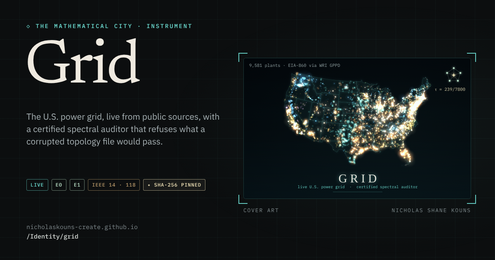

# Grid

**Live U.S. power-grid monitor with a certified spectral auditor.**
Open it at **https://nicholaskouns-create.github.io/Identity/grid/**. It runs entirely in the browser, installs as an app, and keeps working offline on its last certified state.

Grid reads public publishers directly where they allow browser access, and through a scheduled relay where they do not. It draws the grid on night-light, satellite and 3D terrain maps that you can fly from your own GPS position. Beside the map, the certified auditor from the *certified spectral monitor* specification runs on the IEEE 14-bus and 118-bus systems. Their operating point is driven by live U.S. demand, and a corrupted runtime topology file is refused, not passed.



## Views

| Tab | What it shows |
|---|---|
| **Map** | Night-light, satellite and terrain scenes on a globe. Layers: transmission lines (HIFLD), the local grid around you (OpenStreetMap), 9,833 generating plants and a 3D generation skyline, severe-weather warnings, wildfires and perimeters, earthquakes, the auroral oval, last night's VIIRS Day/Night Band, the day–night terminator. Side panels show Lower-48 demand, fuel mix, operator load, space weather, the hazard exposure at your position, and the auditor. |
| **Fly** | The map as a flight instrument, using the same imagery registry as the City flight simulators. W/S pitch, A/D roll, Q/E yaw, Z/X throttle, **P** flies the nearest transmission line, Esc exits. The HUD shows heading, ground speed, altitude and height above terrain, and position. It also names the nearest plant and the nearest line, and flags any active weather warning over the aircraft. |
| **Auditor** | Five replicas, five pipelines and the hash-chained decision ledger, live. You can inject each fault class (L0, CM2, H1, E1, CM6) and watch every pipeline decide. You can also run the acceptance protocol in a worker and compare it with the Python reference. |
| **Formalism** | The window Λ, the gap g, the envelope ε₀ and the tolerance τ for each system, with every inertia count of the exact certificate recomputed over ℚ in the browser. Also the E47 reference instantiation computed live and checked against the City's E47 lock. |
| **Sources** | Every source with its publisher, evidence class, status and age. Also the EIA key, alerts, wall mode, install, and the doorway survey. |

## Evidence grammar

Every number carries one of six marks, so a reading is never presented as more than it is.

| Mark | Class | Meaning |
|:-:|---|---|
| ● | Live | Fetched from the publisher in this session |
| ◆ | Relay | Fetched server-side by the Grid relay (GitHub Actions) and served as a snapshot with its generation time |
| ■ | Published | Fixed published dataset, version stated |
| △ | Model | Computed in this browser from live inputs and stated formulas |
| ○ | Simulated | Synthetic perturbation or injected fault (auditor benchmark) |
| ✦ | Certified | Exact arithmetic against a SHA-256-pinned certificate |

When a source is down, its panel says so. Nothing is filled in.

## Sources

| Source | Publisher | Class | Refresh |
|---|---|:-:|---|
| Planetary K-index, 1-minute and 3-hour | NOAA Space Weather Prediction Center | ● | 1 min |
| Space-weather scales G/S/R | NOAA SWPC | ● | 5 min |
| Space-weather alerts, watches, warnings | NOAA SWPC | ● | 5 min |
| OVATION aurora probability | NOAA SWPC | ● | 15 min |
| Severe and extreme weather alerts | National Weather Service API | ● | 2 min |
| Earthquakes M2.5+, past day | USGS Earthquake Hazards Program | ● | 2 min |
| Wildland fire incidents | NIFC WFIGS | ● | 10 min |
| Wildland fire perimeters | NIFC WFIGS | ● | 15 min |
| Transmission lines | HIFLD via DOE NETL ArcGIS | ● | on view |
| Local power infrastructure | OpenStreetMap via Overpass | ● | on request |
| EIA-930 hourly demand, forecast, generation by fuel, interchange | U.S. EIA API v2 (free key) | ● | 10 min |
| ISO/RTO real-time load and fuel mix: CAISO, ERCOT, ISO-NE, MISO, NYISO, SPP, and PJM with a key | Grid relay: GitHub Actions + `gridstatus` | ◆ | 10 min |
| World imagery, hillshade, boundaries | Esri | ● | tiles |
| Terrain elevation (Terrarium) | AWS Open Data Terrain Tiles; JAXA AW3D30 fallback | ■ | tiles |
| VIIRS Black Marble and daily Day/Night Band | NASA GIBS | ● | daily |
| 9,833 U.S. generating plants | WRI Global Power Plant Database v1.3.0 (EIA-860) | ■ | fixed |
| IEEE 14-bus and 118-bus systems | MATPOWER case files via PYPOWER 5.1.21 | ■ | fixed |

Privacy: your GPS position stays on your device. The only time any of it leaves is as the bounding box of an Overpass query, and only when you ask for the local grid. The EIA key is stored in your browser and sent only to `api.eia.gov`.

## The relay

Several operators do not allow browser access. For them, `.github/workflows/grid-live.yml` runs every 10 minutes:

1. It installs `gridstatus` 0.37.0.
2. It fetches each operator's public endpoint, plus EIA-930 when a key is present.
3. It keeps a rolling 24-hour history.
4. It force-pushes `live.json` and `door.json` to the orphan branch **`grid-live`**. That branch has no history, so it never grows.

Grid reads the snapshot from `raw.githubusercontent.com`. The doorway on every City page shows a one-line reading from `door.json`.

**Turning it on in the GitHub website:**

1. Get a free EIA key at https://www.eia.gov/opendata/register.php. It arrives by email within a minute.
2. Open the **Identity** repository and go to **Settings → Secrets and variables → Actions → New repository secret**. Set **Name** to `EIA_API_KEY`, paste the key, and click **Add secret**. If you have a PJM Data Miner key, add it the same way as `PJM_API_KEY`.
3. Go to **Actions → Grid live relay → Run workflow → Run workflow**.
4. When the run turns green, a `grid-live` branch appears. Grid picks it up within five minutes, and the schedule keeps it fresh after that.

Without the secret, the relay still publishes the ISO/RTO data. The EIA panel then reads the key from the browser instead (**Sources → EIA-930 key**).

## The certified auditor

**System.** A is the DC susceptance Laplacian of the network, with W = I. The window is Λ = {λ₂, λ₃}, the slowest inter-area modes. The stable mode is the spectral projector P_d onto that window.

**Formalism.** g is the separation of Λ from the rest of the spectrum. The noise envelope is ε₀ = g/40. The Davis–Kahan bound s(ε) = ε/(g − ε) gives s(ε₀) = 1/39. With ρ = 1/200, the tolerance is

  τ = s(ε₀) + ρ = **239/7800 ≈ 0.030641**.

**Replicas.** Five replicas isolate the stable mode from the same noisy state vector:

- R1 Jacobi;
- R2 Householder with implicit QL;
- R5 Lanczos with full reorthogonalisation;
- R3, with no eigensolver: the Newton matrix-sign function of (U·I − A)(A − L·I);
- R4, with no eigensolver: resolvent subspace iteration.

R1, R2 and R5 share one window-selection helper. That shared helper is the common-mode H1 fault.

**Auditor deviation.** dev(y, x) = ‖y − P_d x‖ / ‖x‖. The auditor makes one of three decisions:

- **Deliver certified** when the voted output has dev ≤ τ.
- **Select certified** otherwise: it tests each replica in order, delivers the first that passes, and records which replica it used and why the vote failed.
- **Refuse** when none passes: it keeps the last certified state and raises a topology-reprocessing alarm. It logs the deviation of every replica, the runtime topology hash and the certificate hash.

Each decision is appended to a hash-chained ledger in the browser.

**Live input.** The state vector is the DC power-flow solution of the system with every load and generator scaled by the live demand ratio. Grid takes that ratio from EIA-930 Lower-48 demand. If that feed is unavailable it uses the relay's ISO load ratio, and failing that a diurnal model. The ratio is clamped to 0.8–1.2, and the screen marks which source is in use with its evidence class. Operator EMS state vectors are not public, so the auditor runs on the public IEEE systems at the load level that today's U.S. demand sets.

## Certificates and pins

Each system ships a topology model and a certificate.

- **Exact branch.** The certificate gives an enclosure of Λ and of the gap. Those rest on inertia counts of A − σI at rational shifts σ, computed by exact sparse LDLᵀ over ℚ with a minimum-degree order.
- **Re-verification.** The browser recomputes these counts with BigInt rationals before the auditor starts:
  - IEEE 14: all of them.
  - IEEE 118: the critical ones. All 122 are one click away on the Formalism tab.
- **Tampering.** An altered certificate fails its pin and is refused.

| File | SHA-256 |
|---|---|
| `topology-ieee14.json` | `12a4c9838465b1808c2a06d02eee4970603ed99caae9250583ea8b8f6d7db775` |
| `certificate-ieee14.json` | `224054adeaa0600300b8141c435d04cbf2c9a22bee8cb91e1bdac2ad8ff0668e` |
| `topology-ieee118.json` | `10d06382a19d8dd252a9ca87a817ac1fafddb53960af928cdf5fd338c2b54e87` |
| `certificate-ieee118.json` | `6beaaab55f50acaa55bf7d49f44dbfc5ef765bbb98928ceddd1c745471d050a1` |

The pins live in `engine/pins.js`. They cover the certificate and the topology model used to build A. The **runtime** topology file is deliberately not pinned, as the specification requires. CM2 is exactly that case: one branch status in the shared runtime topology file flipped, which changes A for every replica at once.

## Acceptance — KKP-GRID-ACCEPTANCE-1.0

The same harness runs on both systems.

| | | |
|---|---|---|
| **Fault classes** | L0 (legitimate)<br>CM2 (one runtime topology entry altered)<br>H1 (shared helper defect)<br>E1 (envelope breach)<br>CM6 (spoofed input) | |
| **Trials** | 240 per class on IEEE 14<br>40 per class on IEEE 118 | |
| **Seed** | 47 | |
| **Harmful** | delivered y with ‖y − P_d x‖/‖x‖ > τ | |

**Harmful outputs passed** (CM2 + H1 + E1 + CM6):

| Pipeline | IEEE 14 | IEEE 118 |
|---|--:|--:|
| Voting (majority of 5 within τ) | 563 | 84 |
| Validated residual | 545 | 84 |
| Independent reference | 305 | 44 |
| Anomaly detector | 28 | 0 |
| **Certified auditor** | **240** (all CM6) | **40** (all CM6) |

**Auditor decisions and false alarms:**

| | IEEE 14 | IEEE 118 |
|---|--:|--:|
| Certified auditor, harmful passed outside CM6 | **0** | **0** |
| False alarms on legitimate trials: auditor | **0** of 240 | **0** of 40 |
| False alarms on legitimate trials: anomaly detector | 2 of 240 | 0 of 40 |
| Certified outputs delivered by auditor selection | 281 | 41 |
| Auditor refusals (last certified state kept, alarm raised) | 44 | 3 |
| Largest legitimate deviation vs tolerance | 0.0073 vs 0.0306 | 0.0010 vs 0.0306 |

Decision-log SHA-256:

- IEEE 14: `e498955c3c2a85a3ab6b28e4686323ffe4caab1f095d018bbbc2752449476841`
- IEEE 118: `56a55f3d9daf782946d6e0fff71272df30074b40468b7e9fc1201cd29fc35267`

The browser engine uses the same Mulberry32 and Box–Muller streams and the same per-trial seeds as the Python reference. `engine/monitor.test.mjs` asserts that the two agree decision by decision.

**Limits, as specified.** The auditor certifies the spectral component of the input it receives. Under CM6 the input itself is spoofed, so it passes all of them. Input integrity and certificate-pin integrity are separate controls. Grid shows the CM6 row rather than hiding it.

## E47 reference instantiation

The Formalism tab computes the E47 instantiation from scratch:

- H = V₂ ⊗ V₂ ⊗ V₂, of dimension 125;
- the spin-2 Casimir C and K = (C − 6I)(C − 30I), with dim ker K = 47;
- Γ = I − K²/99144, and the curve ‖Γⁿ − P‖ ≤ (15/17)ⁿ, attained at x*.

It checks the sector dimensions, tr P = 47 and the rate 15/17 against the City's `E47_LOCK`, imported live from `E47-Kartekeya/interfaces/shared/e47-lock.js`, with an embedded copy as fallback.

## Doorways

`tools/grid/install_door.py` surveys every published page across the nine Pages repositories:

- It places a **GRID** doorway on each page, as plain HTML that works with scripts off. A small script, `door.js`, moves the doorway clear of the page's own fixed panels and controls, including those inside same-origin embeds. It also shows the relay reading, and stays hidden inside iframes.
- It adds a lead card to the five hub pages.
- It writes the survey to `data/surfaces.json`. The Sources tab lists it in full: 184 published pages and one generator template.

The installer is idempotent, so you can rerun it after adding pages.

## Reproduce

```bash
# data, certificates and pins (GPPD CSV, us-atlas states, gridstatus BA metadata as inputs)
python3 tools/grid/build_grid_data.py --gppd <gppd.csv> --atlas <states-10m.json> --ba <grid_monitor_files.json>

# Python reference acceptance run → grid/data/reference-acceptance.json
python3 tools/grid/acceptance.py --trials14 240 --trials118 40 --seed 47

# browser engine agrees with the reference, trial by trial
node --test grid/engine/monitor.test.mjs

# share card and cover art (headless Chrome)
python3 tools/grid/render_share_card.py --chrome /usr/bin/google-chrome

# doorways and lead cards across the sibling checkouts
python3 tools/grid/install_door.py --root <folder holding the repos> [--dry-run]

# one relay run by hand
pip install gridstatus==0.37.0 requests
EIA_API_KEY=... python3 tools/grid/relay.py --out out
```

## Layout

```
grid/
  index.html, app.js, grid.css     the instrument
  map/       map.js (scenes, layers, terminator, GPS), fly.js (flight model, HUD, line patrol)
  live/      sources.js (publishers, parsers, evidence classes)
  engine/    linalg, rational, certificate, monitor, e47, prng, worker, pins
  ui/        charts, panels, pages
  data/      topologies, certificates, CM2 surveys, plants, states, BA metadata, reference run, doorway survey
  lib/       MapLibre GL JS 6.19.0 (vendored)
  fonts/     Newsreader, IBM Plex Sans and Mono, DejaVu Sans Mono (formula glyphs), with licences
  sw.js, manifest.webmanifest, door.js, og-grid.png, cover-grid.jpg, icons/
tools/grid/  build_grid_data.py, acceptance.py, prng.py, relay.py, render_share_card.py, share_card.html, install_door.py
.github/workflows/grid-live.yml
```

## Attribution

- Map rendering: MapLibre GL JS (BSD-3-Clause, `lib/maplibre/LICENSE.txt`).
- Imagery: © Esri, Maxar, Earthstar Geographics.
- Night lights and Day/Night Band: NASA GIBS / VIIRS.
- Terrain: AWS Open Data Terrain Tiles (SRTM, NED, GMTED), with JAXA AW3D30 as fallback.
- Transmission lines: HIFLD, via DOE NETL.
- Local grid: © OpenStreetMap contributors (ODbL).
- Plants: WRI Global Power Plant Database (CC BY 4.0), from EIA-860.
- Public U.S. government data: NOAA SWPC, the National Weather Service, USGS, NIFC and EIA.
- Operator data: each ISO/RTO's public endpoints, through `gridstatus`.
- Test systems: MATPOWER / PYPOWER.
- Fonts: SIL Open Font License, and the DejaVu licence.
